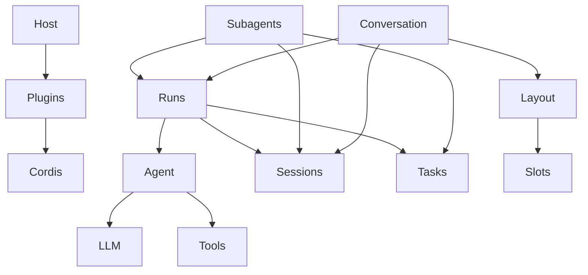
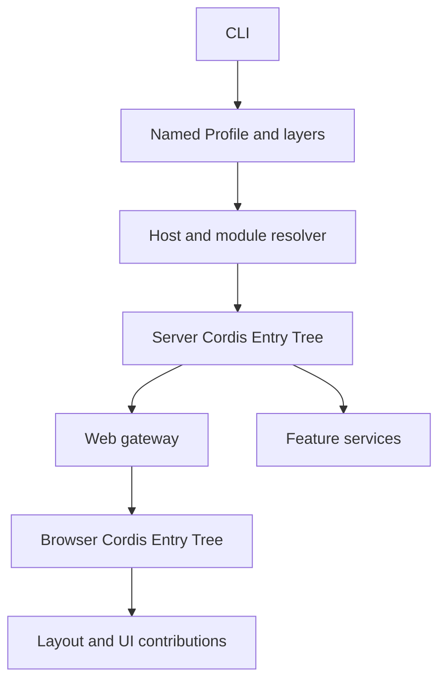
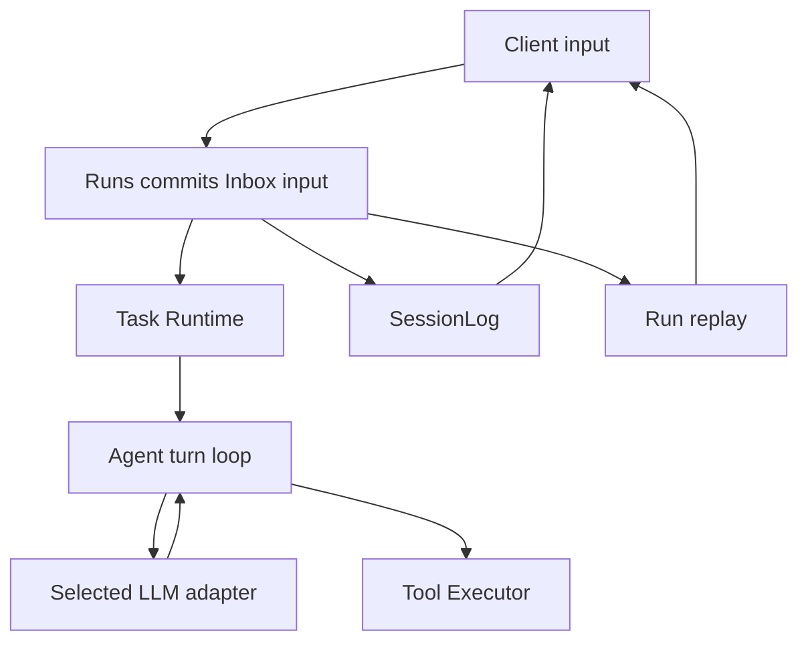

# Architecture

mini-harness is a native agent harness distributed as one npm package. The application is a composition of Cordis plugins rather than a fixed product kernel. The private packages define source ownership; the root package.json defines the public installed SDK.

## Boundaries and dependency direction

This is a selected capability dependency map, not a complete import graph. Arrows point from consumer to provider. The [package index](packages.md) covers every source package. The framework and platform libraries provide generic mechanisms; the domain layers compose them into execution and persistent conversations; presentation and optional feature plugins consume those contracts.

## Application composition

The launcher supplies paths, process controls and the Profile. Native declarations are mounted through Cordis dependency injection, with scoped replacements in child Contexts. The browser composes its own graph from the published bootstrap. Configuration updates reconcile a candidate before committing it. Disposal follows activation ownership and drains affected work; see [composition](subsystems/composition.md) and [Cordis](cordis.md).

## Message execution

A Run is a Task with a conversation-specific lane and durable projection. Agent executes native model turns; the LLM adapter translates the protocol and Tools invokes the selected tool provider through its Cordis Fiber. Subagents submit independent child conversation runs through the same contracts. The client reads durable history and transient replay without owning execution. See [execution](subsystems/execution.md) and [sessions](subsystems/sessions.md).

## State ownership

| State or resource                                                                  | Owner        |
| ---------------------------------------------------------------------------------- | ------------ |
| Profile layer loading and accepted YAML persistence                                | Host         |
| Service activation, injection, effects and Entry lifecycle                         | Cordis       |
| Configuration reconciliation, plugin resolution, scope bindings and browser assets | Plugins      |
| Workspace identity and canonical roots                                             | Workspaces   |
| Conversation identity, ancestry, branch history, inbox records and attachments     | Sessions     |
| Live task state, exclusive lanes, capacity and settlement                          | Tasks        |
| Conversation admission policy, model selection for a run, transient replay         | Runs         |
| Tool registrations and invocation contract                                         | Tools        |
| Provider credentials/catalog, recent application model                             | Models       |
| Pending confirmations                                                              | Approvals    |
| HTTP registrations and projection revisions                                        | Transport    |
| Selected conversation and composer drafts                                          | Conversation |
| Workspace-owned open tabs and page/dialog contributions                            | UI Layout    |
| Slot registry, contributions and renderer lifetime                                 | UI Slots     |
| Theme configuration and visual tokens                                              | UI Theme     |

The owner exposes the authoritative contract; a derived view, historical record or transport projection is not another mutable owner.

## Extension model

Plugins declare the services they consume and contribute or replace capabilities at existing extension points. Public SDK specifiers belong to the owning packages. Runtime resource scopes inherit from the configured ancestors. Browser code imports only the published browser-safe modules and shares no server objects. For workspace files and previews see [frontend](subsystems/frontend.md); for HTTP and projection synchronization see [transport](subsystems/transport.md).

Start with [plugin development](cookbook/creating-a-plugin.md), the [SDK reference](plugins.md), or the [package index](packages.md).
